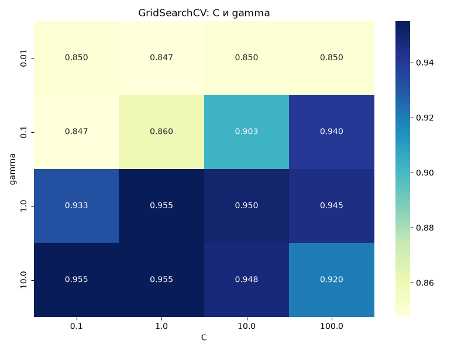

# Практическая работа №9 — SVM

## Вариант B

### Цель работы
Исследовать влияние параметров C и gamma на качество SVM.

### Выполненные задания
1. Создан Pipeline с StandardScaler и SVC.
2. Проведен GridSearchCV для C и gamma.
3. Построена тепловая карта.
4. Выполнено сравнение RBF и линейного ядра.
5. Проанализированы результаты.

### Результаты

| Модель | Точность |
|---|---|
| SVM RBF | 93% |
| SVM Linear | 83% |

Лучшая точность кросс-валидации: 95.5%.

Время поиска параметров RBF: 1.558 сек.

Время обучения Linear SVM: 0.003 сек.

### Тепловая карта

### Вывод

Модель SVM с ядром RBF показала точность 93%,
а линейная модель — 83%.

RBF лучше подходит для нелинейных данных.
Подбор параметров C и gamma влияет на качество модели.

Применение SVM с ядром RBF оправдано.

Исследование выполнено на учебных данных make_moons.
Сравнение с ПР-7 и ПР-8 пока не выполнено.

# Практическая работа №9 — SVM

## Вариант B

### Цель работы
Исследовать влияние параметров C и gamma на качество SVM.

### Выполненные задания
1. Создан Pipeline с StandardScaler и SVC.
2. Проведен GridSearchCV для C и gamma.
3. Построена тепловая карта.
4. Выполнено сравнение RBF и линейного ядра.
5. Проанализированы результаты.

### Результаты

| Модель | Точность |
|---|---|
| SVM RBF | 93% |
| SVM Linear | 83% |

Лучшая точность кросс-валидации: 95.5%.

Время поиска параметров RBF: 1.558 сек.

Время обучения Linear SVM: 0.003 сек.

### Тепловая карта

### Вывод

Модель SVM с ядром RBF показала точность 93%,
а линейная модель — 83%.

RBF лучше подходит для нелинейных данных.
Подбор параметров C и gamma влияет на качество модели.

Применение SVM с ядром RBF оправдано.

Исследование выполнено на учебных данных make_moons.
Сравнение с ПР-7 и ПР-8 пока не выполнено.
